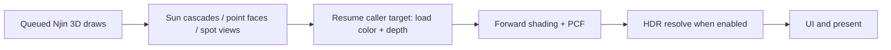

# Raster shadows

The SDL3/bgfx path implements raster shadows for the existing Njin static, animated and
procedural model/primitive APIs. Gameplay continues to use `light3d_set`,
`light3d_add`, `model_material_set`, `begin_3d` and `end_3d`; ECS light/model/shape
components use the same path. The independent raylib renderer retains its own
existing shadow implementation.

```cpp
auto sun = njin::light3d_get(ctx);
sun.shadows = true;
sun.shadow_range = 30;
sun.shadow_size = 1024;
sun.shadow_cascades = 4;
sun.shadow_cascade_split = 0.75f;
sun.shadow_softness = 1;
sun.source_shadow_size = 512;
sun.source_shadows = 4;
njin::light3d_set(ctx, sun);

njin::begin_3d(ctx, camera);
njin::draw_model(ctx, model, transform);
njin::light3d_source lamp;
lamp.position = {0, 3, 0};
lamp.radius = 12;
lamp.shadows = true;
njin::light3d_add(ctx, lamp); // applies to all queued draws, including earlier ones
njin::end_3d(ctx);
```

Set `kind=light3d_spot`, `direction` and `cone` for a spot source. ECS lights take
their world position from `transform3d`. Lighting configuration is snapshotted at
`begin_3d`; configure it before opening the pass.

## Implemented behavior

- A sun uses one orthographic shadow box around the camera target, or 2–4 fitted
  camera-frustum cascades. Cascade splits mix linear/logarithmic distances using
  `shadow_cascade_split`; the final cascade ends at `min(far_plane, shadow_range)`.
  Camera-space diagonal sizing and texel anchoring are adapted from Bevy v0.18.0
  (see THIRD_PARTY_NOTICES.md). Light-space translation is snapped to the texel
  grid and bounds include caster
  depth padding. A single box retains the existing target-centered range meaning.
- Point sources render six perspective faces. Spot sources render one perspective
  view. Up to four shadowed local sources coexist with four sun cascades.
- Mixed-resolution views share a context-owned atlas with a hardware depth buffer.
  Projected depth is packed into RGB24 in an RGBA8 target. This uses portable
  color sampling instead of requiring backend-specific comparison samplers or
  sampleable depth formats. Atlas dimensions are checked against device limits.
- Material `cast_shadows`, `receive_shadows`, `alpha_cutoff`, albedo/vertex alpha,
  double-sided geometry, mirrored transforms and `model_material::shadow_only`
  are respected. The same queued world transform drives the caster and receiver.
- PCF uses nine nearest depth comparisons; `shadow_softness` controls spacing in
  atlas texels. Samples stay inside the current tile. Normal/depth bias reduces
  self-shadowing. Visibility attenuates direct sun/local light, preserving ambient
  light and emission, with both classic and constant PBR materials.
- Moving casters, atlas resizing and repeated contexts are handled. Shadow work
  temporarily suspends and then resumes an HDR or explicit caller target without
  clearing its color/depth. Tone mapping follows the forward pass; draw UI after
  `end_3d` as in the existing HDR contract.



`RenderShadowData` contains only CPU metadata and an opaque engine texture ID.
It is shared immutably between forward packets. Native handles remain private to
the adapters. The context owns the atlas, HDR and white caches until teardown;
unloading a scene model releases its meshes/textures without deleting those caches.
`renderer_resume_target` requires an initialized target and rejects nesting or
feedback. The device submits a new load-preserving pass.

## Limits

The bgfx profile supports 1–4 sun cascades, 0–4 shadowed local sources, sizes
16–8192 subject to hardware/combined atlas limits, and PCF spacing 0–8 texels.
There are at most 28 atlas views and eight stored sun/spot matrices. Point
receivers compute face projection from the source, keeping uniform usage within
the portable shader budget. Larger budgets fail explicitly. Sources beyond the
configured `source_shadows` budget still illuminate without shadows, following
that API's budget semantics; exceeding a positive budget reports a rate-limited
warning. `source_shadows=0` intentionally disables local shadows.

Shadowed spot cones must be below 179 degrees. Invalid settings fail before
replacing light state. Reduce counts/sizes if the atlas cannot fit the device;
the engine does not silently reduce resolution or switch backend.

This is filtered raster shadow mapping. It does not add ray-traced shadows,
contact shadows, colored/transmissive shadows, PCSS, VSM/EVSM, cascade blending or
seamless filtering across point-face boundaries. Bias is currently automatic.
Those quality extensions are separate from the implemented raster path. Skinned
models, instancing and terrain cannot become bgfx casters until those renderer
features themselves are ported. Ray-traced requests remain explicitly rejected
on bgfx; the independent legacy path is preserved. Apple/Web application runtime
is not established by shader compilation or bgfx's platform list.

## Reproduce

Build with the existing renderer recipe and `NJIN_BUILD_RHI_SLICE=ON`:

```powershell
cmake --build build --target njin_shadow_test njin_rhi_slice -j4
build/bin/njin_shadow_test.exe --renderer=vulkan --gpu-validation --frames=90
build/bin/njin_shadow_test.exe --renderer=bgfx-opengl --frames=90
build/bin/njin_shadow_test.exe --renderer=d3d12 --frames=90
build/bin/njin_shadow_test.exe --renderer=opengl --frames=90
ctest --test-dir build -R shadows_ --output-on-failure
```

The fixture checks caster/receiver switches, alpha cutouts, moving/shadow-only and
mirrored casters, every point face, each sun cascade, maximum point/spot atlas
layouts, PCF edges, HDR, target color/depth retention, resize, invalid settings,
resource counts, sub-texel camera stability and two contexts. The original RHI scene additionally exercises
packed depth and sampler/state reset through both adapters. Vulkan diagnostics
are treated as failures. The legacy fixture uses its existing high-level target
path; the new explicit target load control applies to bgfx.

For an attached Android device, follow [the APK build instructions](../examples/android_renderer/README.md):

```powershell
python examples/android_renderer/build_apk.py --engine-build build-android-pivot
python examples/android_renderer/run_device.py --serial DEVICE_SERIAL --renderer vulkan `
  --suite shadows --apk build/android-renderer/njin-renderer-test.apk `
  --out build/device-shadows-vulkan --lifecycle --rotate
python examples/android_renderer/run_device.py --serial DEVICE_SERIAL --renderer gles `
  --suite shadows --out build/device-shadows-gles --lifecycle --rotate
```

Device captures are produced by Njin, not desktop screen capture. The controller
requires native assertions, a stable PID, portrait acknowledgment and the actual
requested backend in logcat. Android Vulkan validation layers are not enabled by
these commands. Input/audio controls use the separate `models` suite.


## Verification checkpoint — 2026-11-03

- Windows GCC/MinGW: complete **26/26 in 209.79 s**,
  `build/shadow-stable-windows-tests.log`. Includes Vulkan, D3D12, bgfx GL,
  legacy GL, common adapter packed-depth controls and Vulkan validation.
- Native Linux GCC with X11/Xvfb and Mesa software Vulkan/GL: **20/20 in
  105.10 s**, `build/shadow-linux-tests.log`. This is software-driver evidence.
- Independent `NJIN_BGFX=OFF` legacy build: **7/7 in 18.41 s**,
  `build/shadow-stable-legacy-tests.log`.
- Connected arm64 Mali-T880 device: Vulkan and GLES **PASS 0** with stable PIDs,
  background/resume and portrait acknowledgment, including sub-texel camera
  stability. Results/captures are in `build/android-device-captures/` under
  `shadows-stable-vulkan` and `shadows-stable-gles`. The original model/PBR/HDR
  suite with silent audio and two contexts also passed on both backends under
  `shadows-model-regression-vulkan` and `shadows-model-regression-gles`.
- The Metal fragment shader compiled (`build/shadow-metal-fs.log`); Apple
  application compilation/runtime remains unverified. Android validation layers
  were not enabled. No hardware performance comparison is claimed.

Earlier full runs exposed obsolete shadow-rejection assertions, an incorrect
expected count for context-owned white caches, and a minimized legacy test
window. Those logs were retained; none were reported as clean passes. The fixture
now restores its own Windows window when necessary. Production capture still
rejects minimized/hidden windows, and this handling does not weaken pixel checks.


## Sloped receivers

Testing the supplied animated person scene exposed self-shadowing from comparing
one receiver depth with every PCF neighbor. The shader now computes the
receiver-plane depth at each actual point-sampled texel center. World-position
derivatives are transformed by the current projection Jacobian, so derivatives
do not jump between cascade matrices or point-light faces. Bias uses geometric
normals; material normal maps continue to affect lighting. This removes the
planar artifact without increasing the constant bias and detaching contacts.

The general technique is described in Microsoft's
[Cascaded Shadow Maps: per-texel depth bias](https://learn.microsoft.com/en-us/windows/win32/dxtecharts/cascaded-shadow-maps#calculating-a-per-texel-depth-bias-with-ddx-and-ddy-for-large-pcfs).
Njin's implementation derives its own Jacobians for its projected atlas and
analytic point faces; no Microsoft sample code was imported. The SSAO fixture
includes an unoccluded sloped-plane shadow control in addition to the existing
PCF/cascade/point/spot controls.
