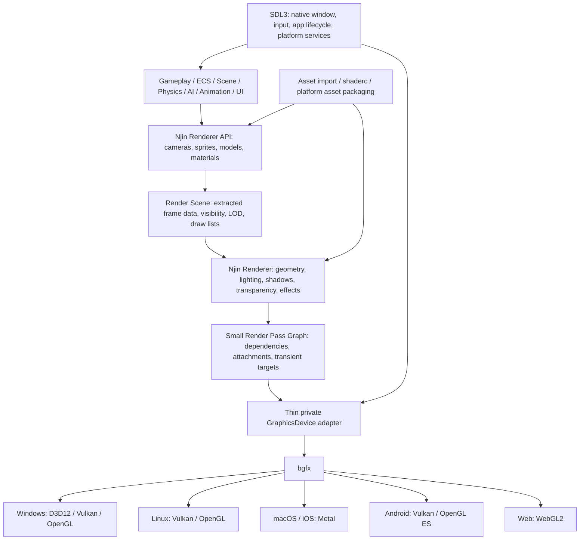

# Njin target renderer architecture

Status: architectural target, 2026-11-03. This is not a claim that the complete
pipeline below is implemented. See renderer-migration.md for verified code and
platform results.

## Runtime boundary

The existing public APIs remain the gameplay entry points. ECS components contain
CPU state and Njin handles, never SDL/bgfx/native graphics objects. Public engine
handles resolve through renderer-owned registries; ownership is explicit for
borrowed target textures, imported model textures and application-owned textures.
A device/resource generation boundary invalidates resources when a context dies.
Assets upload independently for each selected backend; native resources do not
cross renderer/device boundaries.

SDL3 owns the native window and OS lifecycle. Bgfx owns its graphics device,
context, swapchain and GPU resources. The private GraphicsDevice adapter only
translates Njin submissions/resources. Bgfx remains the graphics abstraction;
there is no separate general-purpose Vulkan-shaped RHI below or beside it.

The pass graph belongs above bgfx. It records image dependencies, clear/load/store
intent, target sizes and transient lifetimes. It does not reproduce native
resource barriers, command queues or API-specific synchronization interfaces.

## Frame flow

1. SDL events and engine input snapshots; simulation/fixed update.
2. Animation and transforms; extract immutable render data from ECS.
3. Camera visibility, LOD, opaque/masked/transparent draw lists and batching.
4. Shadow/depth passes and the main scene pass.
5. Optional lighting/screen-space effects, transparency and particles.
6. Tone mapping/anti-aliasing, 2D/UI, engine capture and present.
7. Deferred resource retirement after submissions no longer reference resources.

Extraction and CPU preparation can use worker jobs. Window/events and GPU
submission follow each platform's thread rules. The currently verified renderer
uses one submission thread; multithreaded extraction/submission is future work.
Browser builds require an asynchronous browser frame callback, not a blocking
native run loop. Mobile builds need suspend/resume and surface recreation.

## Image-quality pipeline

The common rendering model is linear-space metallic/roughness PBR, with base
color, normal, emissive and occlusion data, image-based lighting and physically
consistent light units. Unlit materials remain a separate supported mode.

The baseline is Forward rendering. A Forward+ path can be selected where device
capabilities and measured budgets justify compute/light clustering. Mesh data,
materials, scene APIs and asset authoring stay shared between quality paths.

Planned passes/features:

- Opaque and alpha-masked surfaces, deliberate transparent sorting/depth rules.
- Skeletal animation, morphs, static/dynamic instancing and motion data.
- Directional/point/spot lighting, cascaded sun shadows and filtered shadow maps.
- HDR targets, exposure, bloom and tone mapping when supported.
- SSAO, temporal AA, optional SSR and volumetrics with explicit fallbacks.
- Terrain/water/vegetation, CPU/GPU particles according to device capabilities.
- UI and text with physical-pixel font atlas baking and consistent color handling.

Global illumination starts with environment lighting, probes and baked data.
Hardware ray tracing is a separate optional feature; the existing experimental
NVRHI work is not evidence of portable ray tracing through bgfx. Its resource
ownership and native integration must be designed explicitly before migration.

| Quality profile | Intended renderer behavior |
|---|---|
| Compatibility | Forward, reduced shader features and shadow budgets, LOD, FXAA |
| Balanced | PBR/normal maps/IBL, filtered shadows, HDR and bloom where supported |
| High | Expanded lighting/shadow budgets, cascades, SSAO/TAA and optional SSR/volumetrics |

Profiles are chosen from capabilities, memory/frame budgets and measured results,
not OS names alone. Unsupported requested features report a reason; an explicit
profile fallback can simplify effects. A requested graphics backend never silently
changes to another backend. Equal APIs do not promise pixel-identical images or
equal performance on every device.

## Asset pipeline

Source glTF/GLB, images and animation are imported into CPU engine assets. Build
processing validates indices/attributes, prepares LODs and bounds, and compiles
shader variants using pinned bgfx shaderc. Backend shader containers and supported
platform texture formats are packaged reproducibly; runtime paths are relative
to asset packages/application resources, not developer absolute paths.

GPU registry entries own their backend resources. Model assets own imported
textures; a material texture override borrows the application's texture handle.
Releasing a model never releases an unrelated override texture. Resources still
referenced by a frame are retired safely or rejected with a clear lifecycle error.

## Migration and completion criteria

Raylib/OpenGL remains an independent optional legacy renderer during migration,
with existing features and public APIs preserved. Bgfx becomes the main path
only after its required feature set and target applications pass regression tests.
Any change to default selection is versioned and documented.

The final portable core should not require raylib's window/GL implementation.
Image/font decoding, math and audio currently reused from raylib must be isolated
behind CPU/platform adapters or migrated before claiming a raylib-free bgfx build.
The existing CPU-model use of raylib Mesh/Model is private migration storage;
the target asset format and gameplay interfaces remain engine-owned.

Completion requires evidence on each target: compile/link, actual rendering,
resize/surface lifecycle, input/audio lifecycle, resources, shader failures and
controlled captures. Windows hardware, Linux software rendering and Android
archive compilation are different kinds of evidence. Apple/Web/mobile packaging
must not be marked complete from bgfx's platform list alone.

Priority: static models/materials and camera/ECS integration; animation and lit
materials; shadows/instancing; effects/world features; then broader platform
packaging and performance validation in parallel with available host testing.

## Renderer reuse

Use [renderer-reuse.md](renderer-reuse.md) for the renderer-wide O3DE, Bevy, Godot
and compatible bgfx source assessment, adopted components and remaining candidates.

## Current implementation versus target

Startup now defaults to SDL3/bgfx Auto (Windows D3D12, Linux/Android Vulkan,
Apple Metal, Web GLES/WebGL2). Raylib rendering is an explicit legacy override;
its library dependency remains during migration. Platform selection policy does
not establish runtime verification on Apple/Web.

The bgfx path currently renders sprites, static/animated glTF and procedural
models through Njin APIs, with mapped metallic/roughness PBR, normal/AO/emission
maps, SH9/GGX IBL, real GPU instancing, depth, alpha masking, render targets and
basic UI. CPU skinning/morphs produce snapshots shared across draw passes.
An RGBA16F HDR pass with tone mapping and up to 16 point/spot lights is implemented.
Raster sun shadows (1–4 cascades), point/spot shadows and PCF are implemented;
see [renderer-shadows.md](renderer-shadows.md). SSAO, SSR, bloom and FXAA use a
shared shader pipeline. Depth outlines, screen-space sun shafts and lens flare
are also implemented. SMAA/TAA, camera/object motion blur, weighted transparency,
GPU auto exposure and material mipmaps are implemented; see
[renderer-post.md](renderer-post.md). GPU skinning, advanced material lobes,
culling/LOD and complete platform packaging/verification remain separate work.
Advanced features on the legacy renderer remain available on that independent
path; they are not implicitly ported to bgfx.

| Target | Evidence available on 2026-11-04 |
|---|---|
| Windows Vulkan / bgfx OpenGL / D3D12 | Compiled and runtime tested on this host |
| Windows legacy raylib/OpenGL | Independent build and runtime tested |
| Linux Vulkan / OpenGL | Native compilation and X11/Xvfb software-driver runtime tests |
| Android | arm64 APK compiled; Vulkan/GLES runtime on one Mali-T880 device, including background/resume and portrait resize; see Android regression README |
| macOS / iOS / Web | Architecture targets; Njin builds/runtime not verified |

See [renderer-migration.md](renderer-migration.md) for test scope and remaining
features. Complete platform support also requires packaging, surface recreation,
input/audio, shader assets and resource lifecycle evidence on the target itself.

Bgfx platform/backend scope: https://bkaradzic.github.io/bgfx/overview.html .
This document describes Njin design choices above that library, not features
provided automatically by selecting bgfx.
